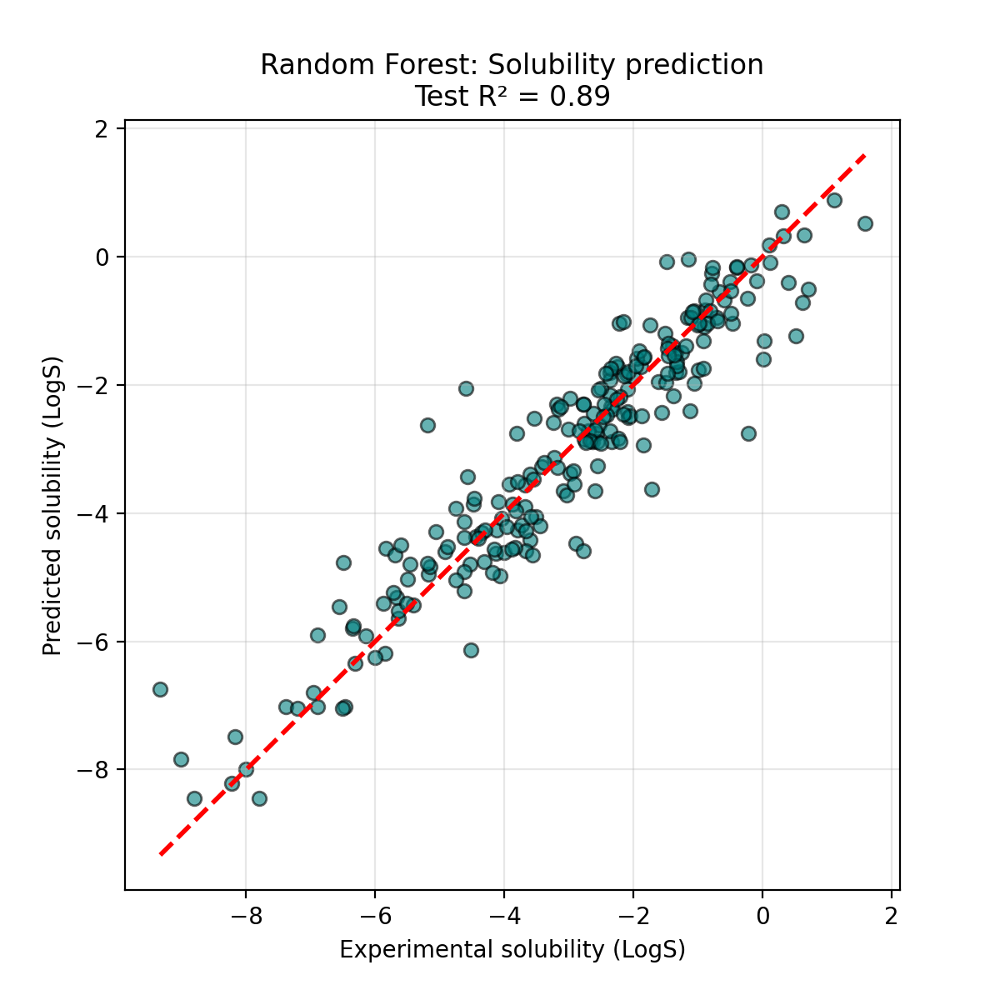
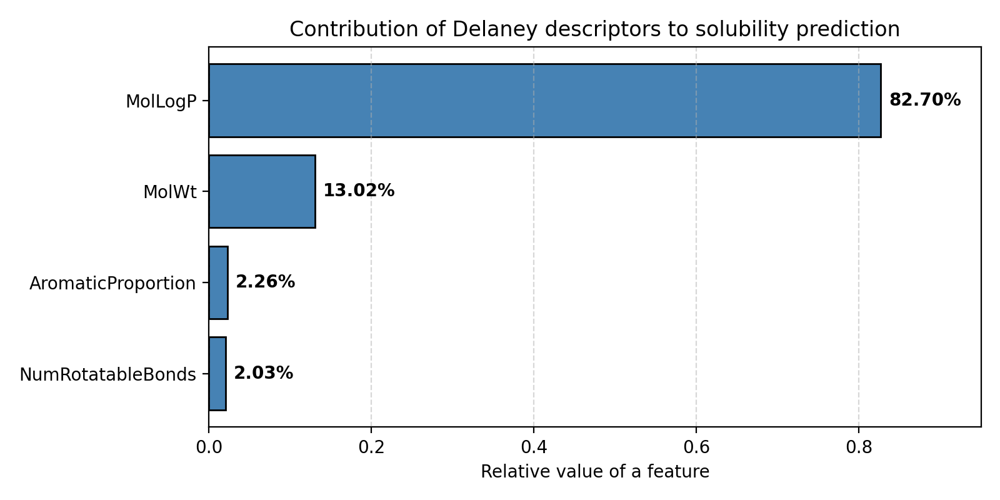

# QSAR Modeling: Aqueous Solubility Prediction (ESOL)

**QSAR (Quantitative Structure-Activity Relationship)** machine learning pipeline designed to predict the aqueous solubility ($\log S$) of organic compounds directly from their chemical structures (SMILES). 

The project systematically benchmarks **Random Forest** and **XGBoost** across multiple molecular featurization strategies and compares standard random splitting with chemically rigorous **Bemis-Murcko Scaffold Splitting**.

---

## Overview
Aqueous solubility is a critical ADME property in early-stage drug discovery. This repository covers the full cheminformatics workflow:
1. **Molecular Featurization:** Generating physicochemical descriptors (Delaney's 4 properties & full 217 RDKit 2D descriptors) and circular structural fingerprints (Morgan / ECFP4).
2. **Validation Strategies:** Implementing both 5-Fold Cross-Validation on random splits and structure-aware **Bemis-Murcko Scaffold Split** (`GroupKFold`) to prevent data leakage from structural analogs.
3. **Model Benchmarking:** Comparing tree-based ensemble models (`RandomForestRegressor` vs. `XGBRegressor`) across 12 distinct experimental setups.
4. **Interpretability & Screening:** Feature importance analysis and virtual screening on well-known pharmaceutical compounds.

---

## Dataset & Featurization
The models are trained and evaluated on the benchmark **Delaney (ESOL)** dataset containing **1,144 organic compounds** with experimentally measured aqueous solubility ($\log \text{mol/L}$).



Four feature representations were generated using **RDKit**:
* **Delaney Descriptors (4 features):** `MolLogP` (lipophilicity), `MolWt` (molecular weight), `NumRotatableBonds` (flexibility), and `AromaticProportion`.
  
  
* **Morgan Fingerprints / ECFP4 (2,048 bits):** Circular topological fingerprints (`radius=2`, `fpSize=2048`) capturing local substructural environments.
* **Combined Representation (2,052 features):** Concatenation of Delaney physicochemical properties and Morgan bit vectors.
* **Full RDKit 2D Descriptors (217 features):** Comprehensive set of topological, electronic, and constitutional molecular descriptors.

---

## Experimental Results & Benchmark

All models were evaluated using **5-Fold Cross-Validation** (`GroupKFold` for scaffold splits) and a 20% hold-out test set:

| # | Experiment | Model | Features | Split | CV $R^2$ (mean ± std) | CV $RMSE$ | Test $R^2$ | Test $RMSE$ |
| :--- | :--- | :--- | :---: | :---: | :---: | :---: | :---: | :---: |
| **1** | Baseline (Delaney 4 desc) | `RandomForest` | 4 | Random | `0.868 ± 0.01` | `0.753` | `0.889` | `0.696` |
| **2** | Morgan Fingerprints (ECFP4) | `RandomForest` | 2048 | Random | `0.657 ± 0.06` | `1.213` | `0.694` | `1.154` |
| **3** | Combined (Delaney + Morgan) | `RandomForest` | 2052 | Random | `0.880 ± 0.01` | `0.723` | `0.905` | `0.645` |
| **4** | **Full RDKit 2D (~200 desc)** | **`RandomForest`** | **217** | **Random** | **`0.893 ± 0.01`** | **`0.679`** | **`0.911`** | **`0.621`** |
| **5** | Scaffold Split (Delaney 4 desc) | `RandomForest` | 4 | Scaffold | `0.784 ± 0.10` | `0.904` | `0.762` | `1.013` |
| **6** | **Scaffold Split (Full RDKit 2D)** | **`RandomForest`** | **217** | **Scaffold** | **`0.829 ± 0.07`** | **`0.787`** | **`0.814`** | **`0.895`** |
| **7** | Baseline (Delaney 4 desc) | `XGBoost` | 4 | Random | `0.855 ± 0.01` | `0.796` | `0.873` | `0.745` |
| **8** | Morgan Fingerprints (ECFP4) | `XGBoost` | 2048 | Random | `0.668 ± 0.05` | `1.200` | `0.722` | `1.099` |
| **9** | Combined (Delaney + Morgan) | `XGBoost` | 2052 | Random | `0.882 ± 0.01` | `0.719` | `0.900` | `0.659` |
| **10** | Full RDKit 2D (~200 desc) | `XGBoost` | 217 | Random | `0.883 ± 0.01` | `0.715` | `0.904` | `0.648` |
| **11** | Scaffold Split (Delaney 4 desc) | `XGBoost` | 4 | Scaffold | `0.750 ± 0.13` | `0.944` | `0.745` | `1.048` |
| **12** | Scaffold Split (Full RDKit 2D) | `XGBoost` | 217 | Scaffold | `0.828 ± 0.07` | `0.796` | `0.791` | `0.949` |

### Key Takeaways
* **Best Overall Performance:** `RandomForestRegressor` trained on the **217 RDKit 2D descriptors** achieved the highest predictive accuracy across both validation schemes (**Test $R^2 = 0.911$, $RMSE = 0.621$** on random split; **Test $R^2 = 0.814$** on scaffold split).
* **Physicochemical Descriptors vs. Fingerprints:** Binary Morgan fingerprints alone ($R^2 \approx 0.69–0.72$) underperform compared to continuous physicochemical descriptors because aqueous solubility is governed by global molecular properties (lipophilicity, molecular weight, polar surface area) rather than isolated local substructures.
* **Impact of Scaffold Splitting:** Evaluating on unseen **Bemis-Murcko scaffolds** causes an expected drop in $R^2$ (~0.09–0.12) and higher fold variance, reflecting the real-world challenge of generalizing to novel chemical series.
* **Feature Importance:** Lipophilicity (**`MolLogP`**) accounts for **>80%** of the predictive power in the baseline model, aligning with established solvation thermodynamics.
---

## Virtual Screening of Pharmaceutical Compounds
Predictions generated by the baseline Random Forest model on well-known drug molecules:

| Compound | SMILES | Predicted $\log S$ |
| :--- | :--- | :---: |
| **Caffeine** | `CN1C=NC2=C1C(=O)N(C(=O)N2C)C` | `-1.30` |
| **Paracetamol** | `CC(=O)NC1=CC=C(C=C1)O` | `-1.31` |
| **Aspirin** | `CC(=O)OC1=CC=CC=C1C(=O)O` | `-2.17` |
| **Ibuprofen** | `CC(C)CC1=CC=C(C=C1)C(C)C(=O)O` | `-3.29` |
| **Cholesterol** | `CC(C)CCCC(C)C1CCC2C1(CCC3C2CC=C4C3(CCC(C4)O)C)C` | `-7.64` |

---

## Tech Stack & Installation

* **Cheminformatics:** `RDKit`
* **Machine Learning:** `Scikit-learn`, `XGBoost`
* **Data Processing & Visualization:** `Pandas`, `NumPy`, `Matplotlib`


### Setup Environment

```bash
git clone https://github.com
cd QSAR-solubility-prediction
pip install -r requirements.txt
```

### Train & Save the Model

Run the training pipeline to evaluate Random Forest on both Random and Bemis-Murcko Scaffold splits, then serialize the final model trained on the full dataset (models/rf_rdkit2d_model.joblib):
```bash
python -m src.train
```

### Predict Solubility via CLI (predict.py)

Pass any valid SMILES string as a command-line argument to predict its aqueous solubility ($log S$) and \(${mol/L}$):
```bash
python predict.py "CN1C=NC2=C1C(=O)N(C(=O)N2C)C"
```
